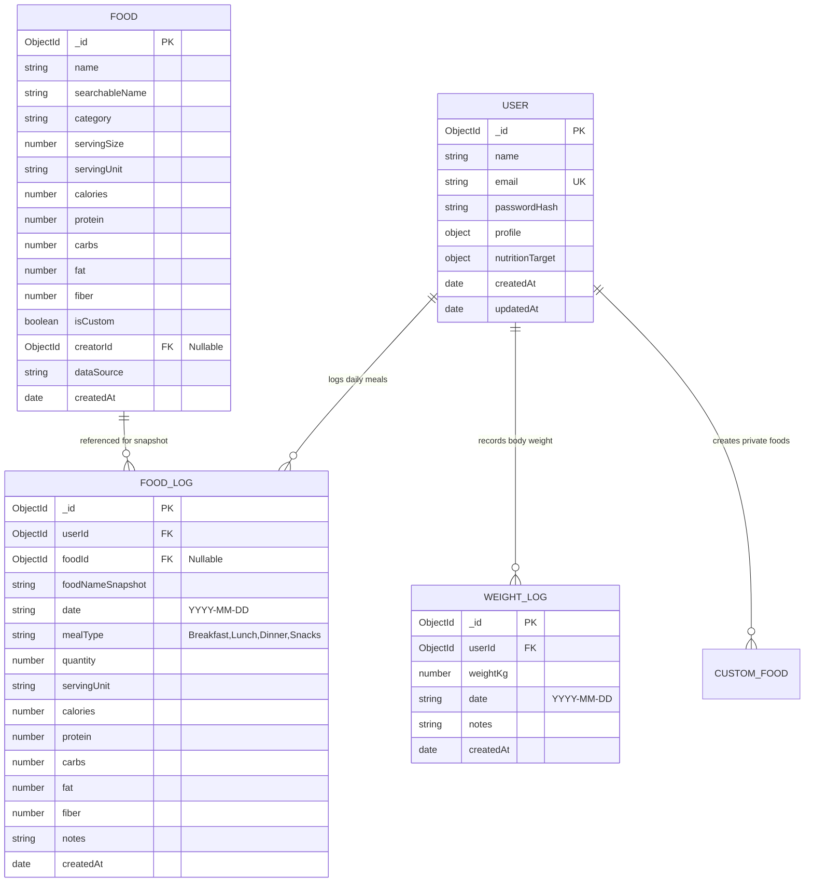

# Database Design Document
## NutriTrack — Smart Calorie & Nutrition Tracker

**Database Engine:** MongoDB 6.0+  
**Data Modeling Framework:** Mongoose ODM  
**Isolation Architecture:** Logical Multi-Tenant by User ID  

---

## 1. Entity Relationship Overview

---

## 2. Collections & Field Specifications

### 2.1 Collection: `users`
* `_id`: `ObjectId` — Primary Key.
* `name`: `String` (Required, Trimmed, Max 100).
* `email`: `String` (Required, Lowercase, Trimmed, Unique index).
* `passwordHash`: `String` (Required, Bcrypt output).
* `profile.age`: `Number` (Optional, 10 - 120).
* `profile.gender`: `String` (`'male' | 'female' | 'other' | 'prefer_not_to_say'`).
* `profile.heightCm`: `Number` (Optional, 50 - 250 cm).
* `profile.currentWeightKg`: `Number` (Optional, 20 - 400 kg).
* `profile.activityLevel`: `String` (`'sedentary' | 'lightly_active' | 'moderately_active' | 'very_active' | 'extra_active'`, default: `'sedentary'`).
* `profile.goal`: `String` (`'maintain' | 'lose' | 'gain'`, default: `'maintain'`).
* `profile.dietaryPreference`: `String` (Optional, default: `'none'`).
* `nutritionTarget.targetCalories`: `Number` (Default 2000, Min 800, Max 10000).
* `nutritionTarget.targetProteinGrams`: `Number` (Default 100).
* `nutritionTarget.targetCarbsGrams`: `Number` (Default 250).
* `nutritionTarget.targetFatGrams`: `Number` (Default 65).
* `nutritionTarget.calculationMode`: `String` (`'automated' | 'manual'`, default `'automated'`).
* `createdAt`, `updatedAt`: `Date` (Automated timestamps).

### 2.2 Collection: `foods`
* `_id`: `ObjectId` — Primary Key.
* `name`: `String` (Required, Trimmed, Max 150).
* `searchableName`: `String` (Required, Lowercase, for partial matching).
* `category`: `String` (Required, 12 standardized food groups).
* `servingSize`: `Number` (Required, Reference quantity, e.g. 100 or 1).
* `servingUnit`: `String` (Required, `'g' | 'ml' | 'piece' | 'cup' | 'slice' | 'tbsp' | 'tsp'`).
* `calories`: `Number` (Required, kcal per reference serving).
* `protein`: `Number` (Required, grams).
* `carbs`: `Number` (Required, grams).
* `fat`: `Number` (Required, grams).
* `fiber`: `Number` (Optional, grams, default 0).
* `isCustom`: `Boolean` (Default `false`).
* `creatorId`: `ObjectId` (Nullable, references `users._id` if custom).
* `dataSource`: `String` (Default `'NutriTrack Standard Library'`).

### 2.3 Collection: `food_logs`
* `_id`: `ObjectId` — Primary Key.
* `userId`: `ObjectId` (Required, Indexed, references `users._id`).
* `foodId`: `ObjectId` (Nullable, references `foods._id`).
* `foodNameSnapshot`: `String` (Required, Immutable historical snapshot).
* `date`: `String` (Required, Format `YYYY-MM-DD`, e.g., `'2026-10-11'`).
* `mealType`: `String` (Required, `'Breakfast' | 'Lunch' | 'Dinner' | 'Snacks'`).
* `quantity`: `Number` (Required, Logged quantity).
* `servingUnit`: `String` (Required, Serving unit used during logging).
* `calories`: `Number` (Calculated integer kcal for this entry).
* `protein`: `Number` (Calculated grams, 1 decimal place).
* `carbs`: `Number` (Calculated grams, 1 decimal place).
* `fat`: `Number` (Calculated grams, 1 decimal place).
* `fiber`: `Number` (Calculated grams, 1 decimal place).
* `notes`: `String` (Optional).

### 2.4 Collection: `weight_logs`
* `_id`: `ObjectId` — Primary Key.
* `userId`: `ObjectId` (Required, references `users._id`).
* `weightKg`: `Number` (Required, 20.0 - 400.0 kg).
* `date`: `String` (Required, `YYYY-MM-DD`).
* `notes`: `String` (Optional).

---

## 3. Index Strategy

1. **`users`**:
   - `{ email: 1 }` (Unique).
2. **`foods`**:
   - `{ searchableName: "text" }` (Fast text search).
   - `{ category: 1 }` (Filtering).
   - `{ isCustom: 1, creatorId: 1 }` (Private custom food retrieval).
3. **`food_logs`**:
   - `{ userId: 1, date: 1 }` (Compound index for fetching daily diary).
   - `{ userId: 1, date: 1, mealType: 1 }` (Meal breakdown aggregation).
4. **`weight_logs`**:
   - `{ userId: 1, date: 1 }` (Compound unique index ensuring 1 weight entry per user per day).

---

## 4. Historical Snapshot Strategy

NutriTrack adopts an **immutable snapshot model** for nutrition logs:
* When a food log entry is created, the system reads the reference food, computes the exact values based on the logged serving size, and stores the food name and all calculated nutrients directly inside the `food_logs` document.
* If a food item is later updated in the database (or deleted), past food entries remain unaffected.
* Users can safely review historical food logs from months ago without discrepancies caused by database changes.
