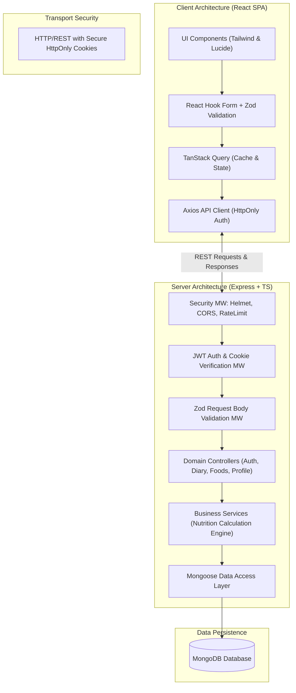
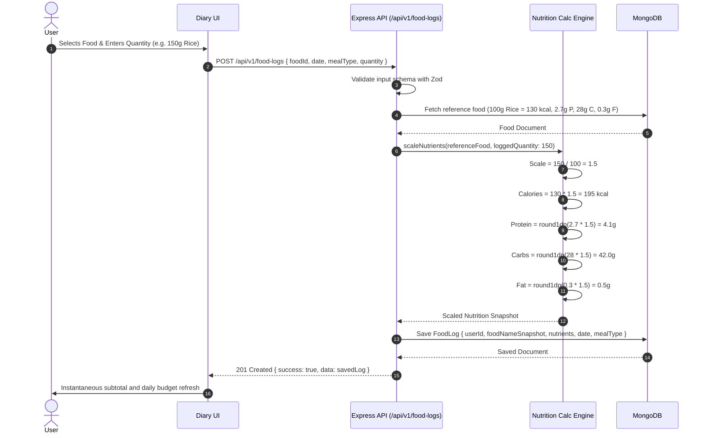

# System Design Document
## NutriTrack — Smart Calorie & Nutrition Tracker

**Document Version:** 1.0.0  
**Status:** Approved for Implementation  
**Architecture Style:** Layered REST API + SPA (Client-Server Monorepo)  

---

## 1. Architectural Overview

NutriTrack adheres to a clean, decoupled client-server architecture:
* **Presentation Layer (Client)**: Single Page Application (SPA) built with React 19 / Vite, TypeScript, Tailwind CSS, Lucide icons, React Hook Form, and TanStack Query.
* **Application / API Layer (Server)**: Modular Express.js REST application in TypeScript, following a Controller-Service-Repository pattern.
* **Persistence Layer (Database)**: MongoDB with Mongoose ODM, leveraging document embedding for snapshots and normalized collections for users and food catalogs.



---

## 2. Authentication Flow

Authentication utilizes signed JSON Web Tokens (JWT) stored in HTTP-Only, SameSite cookies to protect against Cross-Site Scripting (XSS) and unauthorized token harvesting.

```mermaid
sequenceDiagram
    autonumber
    actor User as User Browser
    participant Client as React Client
    participant AuthAPI as Express Auth Controller
    participant Service as AuthService
    participant DB as MongoDB

    User->>Client: Enters Email & Password
    Client->>AuthAPI: POST /api/v1/auth/login {email, password}
    AuthAPI->>Service: authenticate(email, password)
    Service->>DB: findOne({ email: normalizedEmail })
    DB-->>Service: User Document with passwordHash
    Service->>Service: bcrypt.compare(password, passwordHash)
    alt Credentials Valid
        Service->>Service: signJwtToken({ userId: user._id })
        Service-->>AuthAPI: { userSummary, token }
        AuthAPI-->>Client: Set-Cookie: token=JWT; HttpOnly; SameSite=Strict; Path=/<br/>200 OK { success: true, data: userSummary }
        Client->>User: Redirects to Dashboard
    else Invalid Credentials
        AuthAPI-->>Client: 401 Unauthorized { success: false, error: "Invalid credentials" }
        Client->>User: Displays validation alert
    end
```

---

## 3. Food Logging & Calculation Workflow

The food-logging workflow guarantees zero-trust calculation. The client never computes or dictates persisted nutrients.



---

## 4. Error Handling Strategy

All system errors conform to a standardized JSON schema:

```json
{
  "success": false,
  "error": {
    "code": "VALIDATION_ERROR | UNAUTHORIZED | FORBIDDEN | NOT_FOUND | CONFLICT | INTERNAL_ERROR",
    "message": "Human-readable summary of the issue.",
    "details": []
  }
}
```

* **Zod Validation Middleware**: Catches bad payloads and maps issues to `{ field, issue }` without executing business logic.
* **AppError Class**: Custom operational error class carrying HTTP status codes and machine-readable error codes.
* **Global Error Handler**: Intercepts unhandled exceptions, sanitizes database errors (e.g. duplicate key code 11000), logs errors with stack traces on the server, and ensures sensitive internal details are never exposed to clients.
